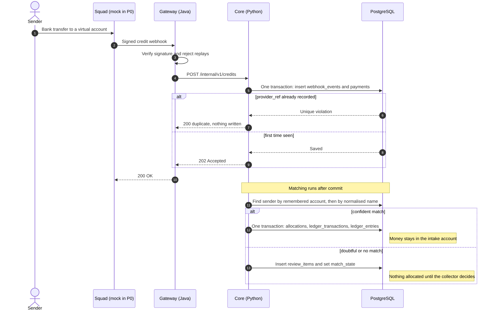
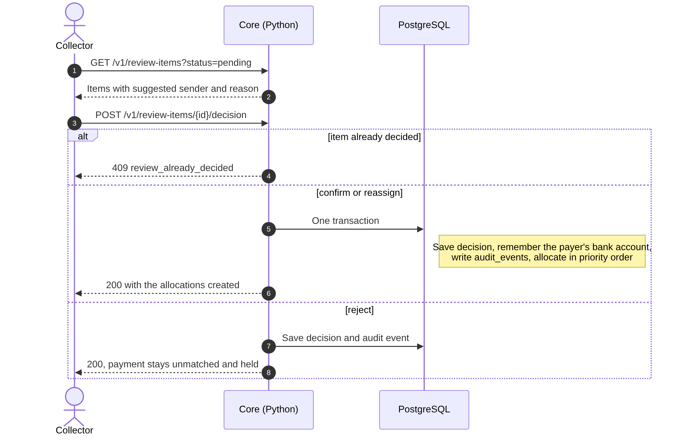
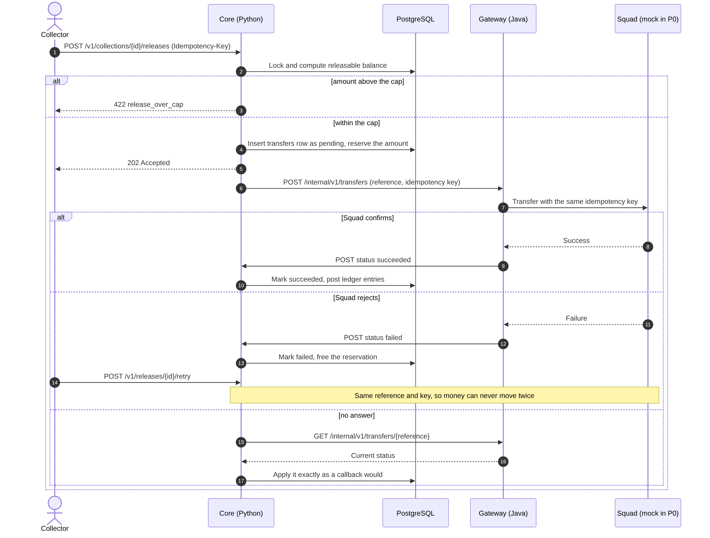
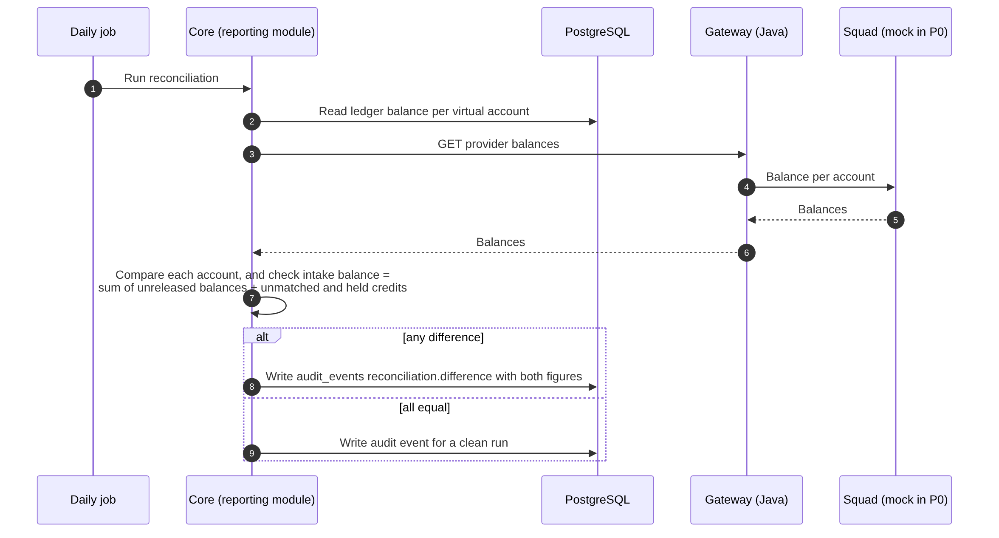

# Collection Point

Collection Point lets a collector receive group payments by ordinary bank transfer and have every payment **identified, allocated and reconciled automatically**.

A collector who gathers money for several purposes (school fees, dues, a wedding, rent) normally receives everything into one bank account and matches each credit to a person by hand. Collection Point replaces that with a virtual account per collection, one intake account per collector, and an append-only ledger that records who paid, how much and for what.

> **Status:** P0 build (initial scope). This README documents the P0 scope: 14 tables, 4 Python services, one small Java gateway, and a mock Squad provider.

## Contents

1. [How it works](#how-it-works)
2. [System context](#system-context)
3. [High-level design](#high-level-design)
4. [Database design (ERD)](#database-design-erd)
5. [Sequence diagrams](#sequence-diagrams)
6. [Design decisions](#design-decisions)
7. [Scope and roadmap](#scope-and-roadmap)

---

## How it works

1. The collector creates **collections**. Each one gets its own virtual account.
2. Senders pay a collection's account directly, or the collector's single **intake account**. Senders never log in.
3. Each credit is matched to a sender. An intake payment is split across that sender's open obligations in the collector's priority order. This is recorded in the ledger only, and the money stays in the intake account.
4. Doubtful matches wait in a **review queue** until the collector decides.
5. The collector **releases** money from the intake account to a collection account, up to that collection's unreleased balance. A release is a real transfer and counts as done only when the provider confirms it.
6. A daily reconciliation compares the ledger with the provider's balances and raises an item on any difference.

**Worked example.** A sender owes three collections and pays 40,000 into the intake account.

| Priority | Collection | Owed | Allocated | Still owed |
| --- | --- | --- | --- | --- |
| 1 | School fees | 30,000 | 30,000 | 0 |
| 2 | Levy | 20,000 | 10,000 | 10,000 |
| 3 | Party fund | 10,000 | 0 | 10,000 |

The collector can then release at most 30,000 to School fees and at most 10,000 to Levy, in any smaller amounts and at any time.

**Rules that never bend**

- Only the middleware writes the ledger. The gateway, reporting and AI never do.
- The auth is for user handling only, it doesn't write on any transaction tables. 
- The ledger and audit log are append-only. Corrections are new reversing entries.
- Every call that moves money carries an idempotency key and a unique reference, so a retry can never move money twice.
- A direct payment to a collection account counts to that collection only.
- A release is capped at the collection's unreleased balance, whatever else the intake account holds.

---

## High-level design

| Component | Owns |
| --- | --- |
| **Middleware** (Python, FastAPI) | The ledger, matching, allocation, review queue, releases, reversals, the audit log. The only service that writes the ledger and the only one that instructs the gateway |
| **Reporting** (Python, FastAPI) | Read only service that returns all the informationl; both analytical and user data needed by the application. |
| **AI Engine** (Python, FastAPI) | Responsible for suggesting matching accounts from the same transfers, and also for user friendly understanding of analytics. |
| **Auth** (Python, FastAPI) | Only service signing user credentials for authentication and autorization purposes. |
| **Gateway** (Java, Spring Boot) | Provider webhooks (signature check, unique provider reference, replay protection), then forwards each credit to the core. Executes transfers with an idempotency key on every Squad call and reports the result back. Holds no ledger and no matching rules. |
| **PostgreSQL** | Payments, allocations, transfers and ledger entries. Append-only tables are protected by a database trigger that rejects update and delete. |
| **Squad provider** | Third party virtual account provider that is responsible for providing virtual account details and sending webhook notification to collection point. |

### Full target architecture

The long-term design adds services that P0 deliberately leaves out: a RabbitMQ queue with a dead-letter queue between the gateway and the core, an AI engine, and a read-only MCP server that gives the AI its only access to data.

| | P0 (this repo now) | Target (HLD diagram) |
| --- | --- | --- |
| Gateway to middleware | HTTP, with retries until the core acknowledges | RabbitMQ queue plus dead-letter queue |
| AI | Not in P0 (P1) | AI engine behind a read-only MCP server, suggestions only |

Guardrails that hold in both: only the middleware writes the ledger, allocation is ledger-only so money moves only when the collector releases it, and AI only suggests while deterministic code decides.

---

## Database design (ERD)

PostgreSQL, 14 tables. Every table also carries a `collector_id` and every query is scoped by it.

**Primary key choice.** Tables that grow fast use a `bigint` identity key. Tables that grow slowly use UUIDv7.

| Key | Tables |
| --- | --- |
| `bigint` identity (high growth) | `webhook_events`, `payments`, `allocations`, `transfers`, `ledger_transactions`, `ledger_entries`, `audit_events` |
| UUIDv7 (slow growth) | `collectors`, `collections`, `virtual_accounts`, `senders`, `sender_bank_accounts`, `obligations`, `review_items` |

Money is stored as integer kobo in `bigint` columns, never floats. The public API uses `reference` and `provider_ref`, not the bigint ids, so row counts are not exposed.

## Database Diagram

Database diagram

.png)

**Table groups**

| Group | Tables |
| --- | --- |
| Setup and accounts | `collectors`, `collections`, `virtual_accounts` |
| Sender registry | `senders`, `sender_bank_accounts`, `obligations` |
| Intake and matching | `webhook_events`, `payments`, `review_items` |
| Allocation and transfers | `allocations`, `transfers` |
| Ledger (append-only) | `ledger_transactions`, `ledger_entries` |
| Audit | `audit_events` |

**Integrity rules enforced in the database**

- `payments.provider_ref`, `webhook_events.provider_event_id`, `transfers.reference` and `transfers.idempotency_key` are unique. This is what makes a repeated webhook or retried release harmless.
- A trigger rejects `UPDATE` and `DELETE` on `ledger_transactions`, `ledger_entries` and `audit_events`.
- A reversal is a new `ledger_transactions` row whose `reverses_transaction_id` points at the original, with mirror entries. The original is never touched.

---

## Sequence diagrams

### 1. Credit intake and matching

A sender's transfer becomes a recorded payment, then a match, then an allocation. A repeated webhook is absorbed without side effects.

Credit intake and matching diagram

### 2. Review decision

The collector resolves a doubtful credit. Allocation happens only after the decision.

Review decision diagram

### 3. Release, failure and safe retry

The only real money movement in P0. A release is capped, carries its own idempotency key, and completes only when the provider confirms.

Release, failure and safe retry diagram

### 4. Daily reconciliation

 Daily reconciliation diagram

---

## Design decisions

Recorded as ADRs.

| ADR | Decision | Why |
| --- | --- | --- |
| 0001 | Record decisions as ADRs | Reviewers read them to judge decision-making. |
| 0002 | Allocation is ledger-only. Money stays in the intake account until the collector releases it. | Fewer transfers, fewer costs and failures. Money moves only when needed. |
| 0003 | Python core plus a small Java gateway | Keeps the Java surface small and the ledger, matching and allocation logic in one language. |

Other choices made for P0:

- **Squad provider**  Uses the sandbox provided by squad.
- **bigint keys for fast-growing tables, UUIDv7 for the rest**, so ids stay compact and index-friendly where volume is high.

---

### Licence

Source-available. The engine stays checkable while the product stays protected.
